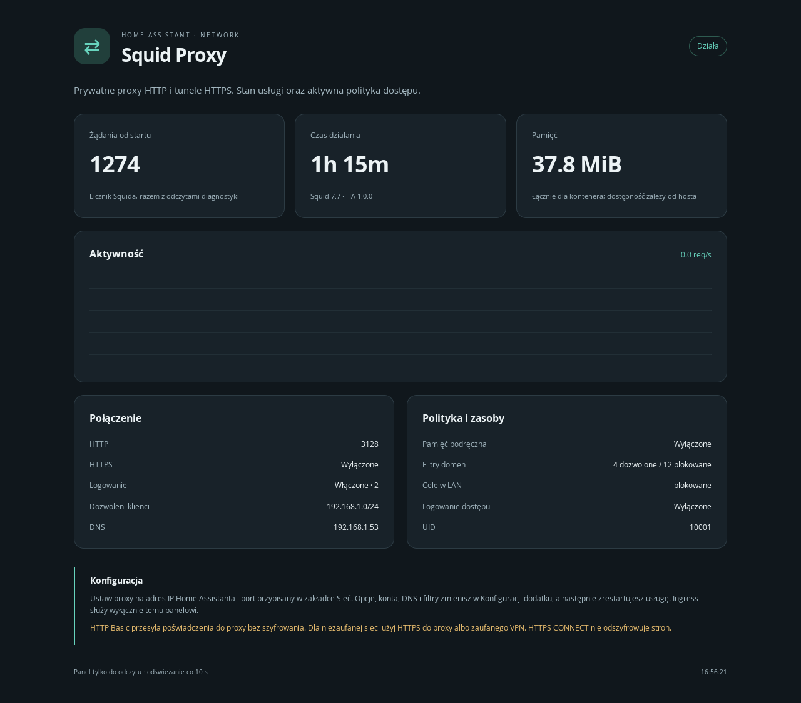

# Squid Proxy for Home Assistant

Uwierzytelniany serwer proxy HTTP/CONNECT oparty na **Squid 7.7**, z lokalnym panelem Ingress PL/EN i 37 opcjami konfiguracji. Obraz Docker buduje się ze źródeł Squida zweryfikowanych SHA-256, na przypiętej bazie Alpine. Obsługuje **amd64 i aarch64**.

- Konta z hasłami bcrypt, listy dozwolonych i zabronionych sieci oraz domen.
- Własne serwery DNS, limity połączeń, rozmiarów i timeoutów.
- Opcjonalne szyfrowane połączenie klient → proxy, pliki certyfikatów HA lub certyfikat własny.
- Cache wyłączony, w RAM lub na dysku; bez zapisywania URL i haseł w logach dostępu.
- Własny profil AppArmor, procesy UID 10001, bez uprawnień do hosta i tokenów API HA.
- Panel z lokalnymi zasobami, stanem usługi, statystykami i wykresem; dostęp przez Supervisor.
- Własne zmienne środowiskowe przekazywane bez powłoki; chronione zmienne są odrzucane.

*Podgląd panelu z danymi testowymi.*

## Instalacja

Dodaj repozytorium `https://github.com/matsob0123/hassio-addons` w sklepie aplikacji Home Assistant, odśwież sklep i zainstaluj **Squid Proxy**. Pierwsze budowanie kompiluje C++ i może potrwać kilkanaście minut; zalecane co najmniej 2 GB wolnej pamięci na czas budowy. Nie wymaga wyłączania trybu ochrony.

1. Ustaw własne `proxy_password`: 16–72 bajty UTF-8. Domyślne puste hasło celowo blokuje start.
2. Zawęź `allowed_networks` do swojej podsieci, np. `192.168.1.0/24`.
3. Uruchom dodatek i otwórz panel Ingress. Skonfiguruj klienta na IP Home Assistanta, port 3128, konto `squidadmin` i swoje hasło.
4. Dla niezaufanej sieci skonfiguruj TLS albo VPN. Basic Auth przez zwykły HTTP ujawnia dane logowania podsłuchującemu; HTTPS strony nie szyfruje połączenia klienta do proxy.

Ingress obsługuje panel, a ruch proxy korzysta z osobnych portów. Nie konfiguruj klienta proxy adresem Ingress.

[Pełna konfiguracja](DOCS.md) · [Bezpieczeństwo i pochodzenie](docs/SECURITY.md) · [Testy](docs/TEST_REPORT.md) · [Aktualizacje co 14 dni](docs/UPDATES.md) · [Zmiany](CHANGELOG.md).

Status **experimental** do potwierdzenia na rzeczywistym HA OS/Supervisor. Testy Docker i AppArmor nie zastępują takiej instalacji.
